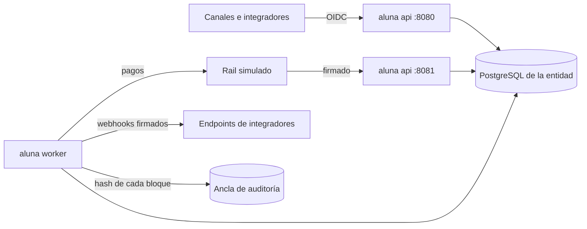

# Arquitectura de uso

Referencia para quien opera o integra Aluna: qué procesos corren y cómo se configuran, cómo se da de alta
una entidad, qué hace cada módulo, cómo viaja un comando, qué eventos salen, qué hace el worker y cómo se
despliega. Los síntomas de una falla y su remedio están en el [runbook](runbook.md); el contrato, en
[`api/openapi.yaml`](../api/openapi.yaml).

## Los procesos

Un solo binario, `aluna`, con un subcomando por proceso.

| Proceso | Qué hace | Rol en la base |
|---|---|---|
| `aluna api` | Sirve la API de los canales en `ALUNA_HTTP_ADDR` y las notificaciones de los rails en `ALUNA_RAIL_ADDR` | `aluna_app` |
| `aluna worker` | Corre los jobs de River: outbox, pagos y [jobs periódicos](#jobs-del-worker) | `aluna_app` |
| `aluna migrate up\|down\|status` | Aplica, revierte la última o lista las migraciones | dueño de las tablas |
| `aluna entity create` | Registra una entidad legal (ver [Alta de una entidad](#alta-de-una-entidad)) | dueño de las tablas |
| `aluna audit verify --from N --to M` | Recalcula la cadena de auditoría de los bloques N a M y la compara con sus anclas | `aluna_app` |
| `aluna healthcheck` | Sale con 0 si la `api` de `ALUNA_HTTP_ADDR` responde `/healthz`; es el `HEALTHCHECK` de la imagen | ninguno |
| `aluna version` | Imprime la versión inyectada al compilar (`-ldflags "-X main.version=…"`) | ninguno |

Se pueden correr varias `api` y varios `worker` sobre la misma base. Los workers eligen un líder, que es el
único que encola los jobs periódicos; todos trabajan los jobs de las colas.



### Configuración

Todo sale del entorno:

| Variable | Procesos | Por defecto | Uso |
|---|---|---|---|
| `ALUNA_DATABASE_URL` | todos salvo `healthcheck` y `version` | obligatoria | Base de la entidad, con el rol de la tabla anterior: el dueño de las tablas, o un usuario miembro de `aluna_app` (o `options=-c role=aluna_app` en la URL) |
| `ALUNA_OIDC_ISSUER` | `api` | obligatoria | Emisor de los tokens, `https` (o `http` solo a esta máquina); se descubre y se le piden las llaves al arrancar |
| `ALUNA_OIDC_AUDIENCE` | `api` | obligatoria | Audiencia que deben traer los tokens |
| `ALUNA_SIMBREB_SECRET` | `api`, `worker` | obligatoria | Secreto, de al menos 32 bytes y el mismo en los dos, con que el rail simulado firma sus notificaciones |
| `ALUNA_AUDIT_ANCHOR_DIR` | `worker`, `audit verify` | esta o la siguiente | Directorio, ya existente, del ancla de los bloques de auditoría: desarrollo, o un volumen WORM que admita enlaces duros |
| `ALUNA_AUDIT_ANCHOR_S3_URL` | `worker`, `audit verify` | esta o la anterior | Bucket S3 con Object Lock del ancla (ADR-0017): `https://<bucket>.s3.<región>.amazonaws.com`, o con la ruta `https://<host>/<bucket>` |
| `ALUNA_AUDIT_ANCHOR_S3_PREFIX` | `worker`, `audit verify` | sin prefijo | Prefijo de las llaves de las anclas en el bucket, por ejemplo `audit` |
| `ALUNA_AUDIT_ANCHOR_S3_REGION` | `worker`, `audit verify` | `us-east-1` | Región del bucket, con la que se firman las solicitudes |
| `AWS_ACCESS_KEY_ID`, `AWS_SECRET_ACCESS_KEY`, `AWS_SESSION_TOKEN` | `worker`, `audit verify` | obligatorias con el bucket (el token, si es temporal) | Llaves que firman las solicitudes al bucket (permisos en el [runbook](runbook.md#el-ancla-de-auditoría-en-s3)). Se leen al arrancar: rotarlas exige reiniciar |
| `ALUNA_AUDIT_ANCHOR_RETENTION_DAYS` | `worker`, `audit verify` | `3653` | Días, de 1 a 36525, que el bucket retiene cada ancla en modo compliance: diez años (Código de Comercio, art. 60). `audit verify` solo lo valida |
| `ALUNA_HTTP_ADDR` | `api`, `healthcheck` | `:8080` | Dirección de la API de los canales |
| `ALUNA_RAIL_ADDR` | `api` | `:8081` | Dirección de las notificaciones de los rails; no se expone a los canales |
| `ALUNA_SIMBREB_NOTIFY_URL` | `worker` | `http://localhost:8081` | A dónde notifica el rail simulado: el puerto de rails de la `api` |
| `ALUNA_GMF_MODALITY` | `api`, `worker` | `single_account` | Exención del GMF: `single_account`, una sola cuenta exenta por titular, o `split_accounts`, los 350 UVT del mes repartidos entre varias |
| `ALUNA_RETURN_REFUND_FEES` | `api`, `worker` | `true` | Si un pago que devuelve el banco del beneficiario reintegra su comisión (`true` o `false`) |
| `ALUNA_RETURN_REFUND_GMF_REASONS` | `api`, `worker` | `AC01,AC03,AC04,AC06,AG01,AG02,AM05,BE04,MD07,MS02,MS03,RC01,RR01,RR02,RR03,RR04` | Causales ISO 20022 de devolución que anulan el pago (la transferencia no se pudo completar) y reintegran su GMF; separadas por coma, y vacía para ninguna. Una causal voluntaria (`CUST`, `MD06`, `FOCR`, `DUPL`) es una operación nueva y no lo reintegra |
| `ALUNA_GMF_RESTORE_EXEMPTION` | `api`, `worker` | `same_month` | Si un pago rechazado por el rail, o devuelto con una causal que lo anula, devuelve a la exención de GMF del mes lo que usó de ella (`same_month`, mientras sea ese mes) o no (`never`) |
| `ALUNA_SCREENING_VENDOR` | `api`, `worker` | `fake` | Con qué se filtra a parties y beneficiarios (FR-42): `fake`, el proveedor falso de desarrollo, o `lists`, contra las listas restrictivas mismas (ADR-0018). Producción usa `lists` |
| `ALUNA_SCREENING_IDENTITY_URL`, `ALUNA_SCREENING_IDENTITY_TOKEN` | `api` | obligatorias con `lists` | Servicio de identidad de la entidad, que dice quién es un sujeto (Aluna no guarda nombres ni documentos), y su token ([contrato](runbook.md#el-screening-contra-las-listas)) |
| `ALUNA_SCREENING_THRESHOLD` | `api` | `0.92` | Similitud de nombres, de 0,5 a 1, desde la que un nombre coincide con uno de una lista |
| `ALUNA_SCREENING_MAX_LIST_AGE_HOURS` | `api` | `48` | Horas, de 1 a 168, que puede tener una lista antes de que el screening la rechace y falle cerrado |
| `ALUNA_SCREENING_OFAC_SDN_URL`, `ALUNA_SCREENING_OFAC_ALT_URL`, `ALUNA_SCREENING_UN_URL`, `ALUNA_SCREENING_PEP_URL` | `worker` | las de sus dueños | De dónde se descargan las listas, para un espejo interno |
| `ALUNA_QUOTE_POLICY` | `api`, `worker` | `lower_of` | Con qué comisión se cobra un pago que esperó a cumplimiento: `lower_of`, la menor entre la de la cotización que nombró al iniciarlo (`quote_id`) y la vigente al despejarlo, o `honor`, siempre la cotizada. Sin cotización se cobra la vigente: el core no le mostró ninguna. El GMF es el del momento del débito |
| `OTEL_EXPORTER_OTLP_ENDPOINT` | `api`, `worker` | sin valor: nada sale del proceso | Exporta trazas y métricas por OTLP/HTTP, con el resto de variables `OTEL_*` |

### Notificaciones de los rails

El puerto `ALUNA_RAIL_ADDR` recibe el resultado de un pago saliente (`POST /v1/rails/simbreb/notifications`)
y la transferencia que otro banco manda a un cliente (`POST /v1/rails/simbreb/transfers`). No llevan token:
el rail firma cada notificación (Standard Webhooks, HMAC-SHA256 con `ALUNA_SIMBREB_SECRET`), y una con otra
firma, o firmada hace más de 5 min, responde 401. El worker envía los pagos por el rail simulado, que
notifica a `ALUNA_SIMBREB_NOTIFY_URL`; decide por la parte entera del monto: si termina en 13 lo rechaza, en
99 tarda más de 20 s en tomarlo, en 07 lo acepta y después lo devuelve, y cualquier otro lo acepta. Una
transferencia recibida se acredita a la cuenta de depósito que nombra si está activa, en su moneda y dentro de
los límites de su producto (cuenta como abono del día y del mes); si no, o si llega por llave (no hay
directorio de llaves), va a la cuenta de suspense del rail y su orden queda `suspended`, con su razón
(`LIMIT_EXCEEDED` si pasaría un límite, `LIMITS_UNAVAILABLE` si sus límites no se pueden calcular: falta el
salario mínimo, o no sirve).
Un pago liquidado que el banco del beneficiario devuelve (`status: returned`, con su razón) queda `returned`:
su monto vuelve de la clearing a la cuenta si sigue activa, o a la suspense si no. En el mismo asiento vuelven
sus cargos según la política de la entidad (ADR-0016): la comisión si `ALUNA_RETURN_REFUND_FEES` es `true`, y
el GMF si la razón está en `ALUNA_RETURN_REFUND_GMF_REASONS` (una causal que anula el pago). Un pago que el
rail rechaza nunca debitó sus cargos: se libera su retención. Tanto el rechazo como la devolución que anula
el pago restauran lo que el pago usó de la exención de GMF del mes, si `ALUNA_GMF_RESTORE_EXEMPTION` es
`same_month` y sigue siendo ese mes.

## Alta de una entidad

1. **Registrarla.** Las entidades no se crean por la API (`aluna_app` no puede insertarlas): quien opera el
   despliegue corre `aluna entity create --name … --business-date AAAA-MM-DD --currency COP [--id …]` con el
   dueño de las tablas. La fecha de negocio inicial debe ser un día hábil que ya empezó en America/Bogota
   (hoy o antes), y la moneda funcional no cambia después. Imprime el id de la entidad, el
   `legal_entity_id` que deben llevar los tokens de sus usuarios; con `--id` toma el que ya emite el IAM.
2. **Cuentas del rail.** Antes del primer pago, alguien con `ledger.accounts.create` crea las dos cuentas del
   rail simulado, pasivos `async` en la moneda de la entidad. Una transferencia recibida debita la clearing,
   y una cuenta `sync` sin saldo la rechazaría. Sin la clearing, o con una que no sea un pasivo `async`,
   `POST /v1/payment-orders` responde 500 sin retener nada.

   ```bash
   for code in L.CLEARING.SIMBREB L.SUSPENSE.SIMBREB; do
     curl -s -H "Authorization: Bearer $TOKEN" -H 'Content-Type: application/json' \
       -d '{"code":"'$code'","kind":"liability","currency":"COP","balance_mode":"async"}' \
       http://localhost:8080/v1/ledger-accounts
   done
   ```

3. **Cuentas de los productos.** Cada versión de producto nombra en `accounts` los códigos de su caja
   (`cash`), gasto de intereses (`interest_expense`), ingreso por comisiones (`fee_income`) y GMF por pagar
   (`gmf_payable`); deben existir en el ledger, en la moneda de las cuentas que se abran y del tipo de su papel
   (`cash` activo, `interest_expense` gasto, `fee_income` ingreso, `gmf_payable` pasivo): una del tipo
   equivocado deja las cuentas de esa versión sin mover dinero, y su código no se puede reusar. `fee_income` y
   `gmf_payable` deben ser `async`, porque el reintegro de los cargos de un pago devuelto las debita: con una
   `sync`, los retiros, transferencias y pagos con cargos de esa versión responden 500 sin mover dinero.
4. **Parámetros de mercado.** Un producto con límites en SMMLV necesita el salario mínimo vigente, y una
   cuenta exenta del GMF, la UVT del año (`POST /v1/market-parameters`, maker-checker).

Sin las cuentas del paso 3 o los parámetros del paso 4, los movimientos que los usan responden 500, que no
queda guardado con la `Idempotency-Key`: se corrige la configuración y se reintenta.

## Los módulos

Cada contexto de negocio es un módulo en `internal/<módulo>/`; los demás solo usan su fachada.

| Módulo | Qué hace | Qué expone por la API |
|---|---|---|
| `access` | Identidad de quien llama (sujeto, entidad, roles, party) y la política de [`config/roles.yaml`](../config/roles.yaml) | Nada propio: autoriza cada operación por su `x-aluna-permission` |
| `accounting` | Mapeo de las cuentas internas a códigos CUIF por periodo, GL diario proyectado desde el journal y cierre de periodo | `POST /v1/cuif-mappings`, `GET /v1/general-ledger/daily`, `POST /v1/accounting-periods/{period}/closure` |
| `approvals` | Maker-checker: guarda el comando sensible como solicitud y lo corre cuando otra persona lo aprueba | `GET /v1/approvals`, `POST /v1/approvals/{id}/approval`, `POST /v1/approvals/{id}/rejection` |
| `audit` | Registro de cada comando de la API de los canales, sellado en bloques encadenados y anclados fuera de la base | Nada: se consulta con `aluna audit verify` |
| `calendar` | Entidades legales, fecha de negocio, días hábiles con los festivos de Colombia y periodos contables | `GET /v1/business-date`, `POST /v1/business-date/rollover` |
| `compliance` | Screening de parties y de beneficiarios de pagos contra listas, casos pendientes y acumulados de efectivo por cliente | `GET /v1/screening-cases`, `POST /v1/screening-cases/{id}/resolution` |
| `deposits` | Cuentas de depósito: apertura, estados, depósitos, retiros, transferencias, intereses, inactividad y extractos | `POST /v1/deposit-accounts`, `GET /v1/deposit-accounts/{id}` y sus `/transactions`, `/statements/{period}`, `/deposits`, `/withdrawals`, `/status-changes`; `POST /v1/transfers` |
| `ledger` | Cuentas, transacciones balanceadas, reversas, holds de dos fases y saldos `sync` o `async` | `POST /v1/ledger-accounts`, `GET /v1/ledger-accounts/{id}` y `/balance`, `POST /v1/transactions`, `GET /v1/transactions/{id}`, `POST /v1/transactions/{id}/reversal`, `POST /v1/holds` y `/capture`, `/release` |
| `party` | Clientes de la entidad con su estado de KYC, versionados; los datos documentales quedan en el sistema de vinculación | `POST /v1/parties`, `GET /v1/parties/{id}`, `POST /v1/parties/{id}/kyc-status-changes` |
| `payments` | Órdenes de pago salientes (screening, hold, envío, liquidación, rechazo o devolución) y entrantes (abono o suspense) | `POST /v1/payment-orders`, `GET /v1/payment-orders/{id}`, `POST /v1/payment-orders/{id}/credit` y `/return-to-sender`; en el puerto de rails, las notificaciones |
| `pricing` | Comisiones y GMF de un retiro o una transferencia, cotizados antes y cobrados exactamente; exención del GMF | `POST /v1/quotes`, `POST /v1/deposit-accounts/{id}/gmf-exemption` |
| `products` | Productos de depósito con versiones inmutables publicadas por maker-checker y parámetros de mercado con vigencia | `POST /v1/products`, `POST /v1/products/{id}/versions`, `GET /v1/product-versions/{id}`, `POST .../publication`, `POST` y `GET /v1/market-parameters` |
| `reconciliation` | Controles continuos sobre el ledger, importación de extractos del rail y breaks hasta que alguien los resuelve | `POST /v1/reconciliation/statements`, `GET /v1/reconciliation/breaks`, `POST /v1/reconciliation/breaks/{id}/resolution` |
| `webhooks` | Events API y entrega de los eventos a los endpoints registrados | `GET /v1/events`, `POST /v1/webhook-endpoints`, `POST /v1/webhook-endpoints/{id}/revocation` |

Además hay piezas transversales sin API propia: la idempotencia, el outbox, la conexión a PostgreSQL, la
telemetría y el adaptador HTTP. La [colección de Postman](postman/README.md) tiene una petición por operación.

## Datos

- **Una base PostgreSQL por entidad regulada.** Los datos de negocio llevan la entidad (directamente o por
  su fila padre), y cada operación se limita a la entidad del token.
- **Un esquema por módulo**: `ledger`, `calendar`, `party`, `products`, `pricing`, `deposits`, `payments`,
  `compliance`, `recon`, `accounting`, `approvals`, `audit`, `access` y `webhooks`; `infra` guarda las claves
  de idempotencia, el outbox, el inbox de sus consumidores y las tablas de River. Los crea
  [`migrations/`](../migrations/), embebido en el binario.
- **El ledger es append-only.** Las transacciones y los entries solo admiten `INSERT`: un trigger rechaza
  todo `UPDATE` o `DELETE`, aun del dueño de las tablas, y `aluna_app` no tiene esos permisos. Un trigger
  diferido rechaza al confirmar toda transacción que no sume cero por moneda. Los registros de auditoría
  tampoco se modifican ni se borran.
- **Dos roles.** El usuario que migra es dueño de las tablas. `aluna_app` no es dueño de nada y solo tiene
  los permisos que cada migración le da: no puede alterar las tablas, ni modificar lo asentado, ni crear
  entidades. En un despliegue, el usuario de `api` y `worker` se hace miembro suyo
  (`GRANT aluna_app TO <usuario>`).
- **Retención.** Las claves de idempotencia se purgan a los 7 días y los eventos publicados a los 30.

## Flujo de un comando

1. **Token.** Cada request a la API de los canales, salvo `/healthz` y `/readyz`, trae
   `Authorization: Bearer` con un token del emisor configurado, con la audiencia esperada, `iat` y una vida
   de 15 min como mucho; si no, 401. De él salen el sujeto, la entidad (`legal_entity_id`), los roles
   (`roles`) y, para un canal, su `party_id`.
2. **Permiso.** La operación declara su `x-aluna-permission`; si ningún rol del token lo da, 403.
3. **Idempotency-Key.** Las operaciones que declaran el header en el contrato lo exigen (400
   `idempotency_key_required` sin él). La clave vale por entidad, sujeto y operación (método y ruta, con el id
   del recurso): la misma con otro cuerpo es 422 `idempotency_key_reused`, y una que todavía corre es 409
   `request_in_progress`.
4. **Una transacción.** En la misma transacción de PostgreSQL se reclama la clave, se aplica el efecto, se
   escriben sus eventos en el outbox y el registro de auditoría del comando, y se guarda la respuesta. Si
   algo falla, no queda nada de eso.
5. **Respuesta.** Un reintento con la misma clave recibe la respuesta guardada byte a byte. Se guardan los
   2xx y los 4xx de negocio; un 5xx no, así que el cliente puede reintentar. Un comando rechazado antes de
   su transacción o que termina en 5xx también queda auditado, en una transacción aparte.

Los errores son `application/problem+json` (RFC 9457) con un `code` estable y, si el request tiene traza,
su `trace_id`. Los montos son enteros de 64 bits en unidades menores.

### Maker-checker

Diez tipos de comando no corren al pedirlos: crean una solicitud pendiente y responden 202.

| Solicitud | Se pide con |
|---|---|
| `ledger.reversal` | `POST /v1/transactions/{id}/reversal` |
| `party.kyc_status_change` | `POST /v1/parties/{id}/kyc-status-changes` |
| `deposits.account_status_change` | `POST /v1/deposit-accounts/{id}/status-changes` que congela o descongela una cuenta (activarla, reactivarla o cerrarla es inmediato y responde 200) |
| `payments.suspense_credit` | `POST /v1/payment-orders/{id}/credit` que abona a una cuenta una transferencia que quedó en suspense |
| `payments.return_to_sender` | `POST /v1/payment-orders/{id}/return-to-sender` que devuelve al banco que la mandó una transferencia que quedó en suspense |
| `compliance.screening_resolution` | `POST /v1/screening-cases/{id}/resolution` |
| `products.publish` | `POST /v1/product-versions/{id}/publication` |
| `products.market_parameter_load` | `POST /v1/market-parameters` |
| `accounting.cuif_mappings_load` | `POST /v1/cuif-mappings` |
| `accounting.period_close` | `POST /v1/accounting-periods/{period}/closure` |

Otra persona, con `approvals.decide` y el permiso del tipo de solicitud, la aprueba
(`POST /v1/approvals/{id}/approval`) o la rechaza (`POST /v1/approvals/{id}/rejection`, con un `reason` que
la solicitud muestra después). Al aprobarla, el comando corre con su cuerpo original en la misma transacción;
si un rechazo de negocio lo detiene, la solicitud queda `failed` y muestra en `failure` el código del problem
que respondió su comando (por ejemplo `already_reversed`). El texto del error, que puede nombrar internos,
queda solo en `approvals.requests.error`, y las que fallaron antes de la migración 0047 no tienen `failure`. Quien pidió no puede decidir su propia solicitud (403 `self_approval_forbidden`), y
una solicitud vence a los 7 días. Los asientos manuales (`POST /v1/transactions`) no pasan por maker-checker.

Un asiento manual, un hold, su captura o una reversa que toque la cuenta del ledger de una cuenta de depósito
bloquea primero esa cuenta, como cualquier movimiento de depósitos, y se rechaza con 409 `account_not_active`
si no está activa (congelada, inactiva o cerrada): el dinero de una cuenta congelada solo se mueve después de
descongelarla, y un asiento no se cruza con el cierre de la cuenta.

## Eventos

Cada evento se escribe en `infra.outbox` en la transacción de su efecto, como CloudEvent con las extensiones
`legalentityid`, `correlationid` y `schemaversion`. Estos son los que emite el código hoy:

| Evento | Lo emite |
|---|---|
| `aluna.ledger.transaction.posted.v1` | Un asiento: `POST /v1/transactions`, depósitos, retiros, transferencias, capitalización de intereses, cobros de un pago liquidado y transferencias recibidas. Las reversas y las capturas de holds emiten su propio evento |
| `aluna.ledger.transaction.reversed.v1` | Una reversa aprobada |
| `aluna.ledger.hold.placed.v1` | `POST /v1/holds` o un pago saliente que el screening despejó |
| `aluna.ledger.hold.captured.v1` | `POST /v1/holds/{id}/capture` o la liquidación de un pago saliente |
| `aluna.ledger.hold.released.v1` | `POST /v1/holds/{id}/release` o el rechazo de un pago saliente |
| `aluna.ledger.hold.expired.v1` | El job `ledger.holds.expire` |
| `aluna.calendar.business-date.rolled.v1` | `POST /v1/business-date/rollover` |
| `aluna.party.party.registered.v1` | `POST /v1/parties` |
| `aluna.compliance.screening.pending.v1` | Un screening de party o de beneficiario con posible coincidencia o sin respuesta del proveedor |
| `aluna.compliance.screening.cleared.v1` | Un screening de party o de beneficiario que despeja, o la resolución aprobada de un caso como no coincidencia |
| `aluna.compliance.screening.confirmed.v1` | La resolución aprobada de un caso como coincidencia |
| `aluna.products.version.published.v1` | La publicación aprobada de una versión |
| `aluna.deposits.account.opened.v1` | `POST /v1/deposit-accounts` |
| `aluna.deposits.account.activated.v1` | `POST /v1/deposit-accounts/{id}/status-changes` que activa una cuenta pendiente o reactiva una inactiva |
| `aluna.deposits.account.frozen.v1` | La congelación aprobada de una cuenta |
| `aluna.deposits.account.unfrozen.v1` | La descongelación aprobada de una cuenta |
| `aluna.deposits.account.closed.v1` | `POST /v1/deposit-accounts/{id}/status-changes` que cierra una cuenta sin saldo ni holds pendientes |
| `aluna.deposits.account.dormant.v1` | El job `deposits.accounts.mark_dormant` |
| `aluna.deposits.interest.capitalized.v1` | El job `deposits.interest.accrue`, en un día de capitalización |
| `aluna.payments.order.initiated.v1` | `POST /v1/payment-orders` |
| `aluna.payments.order.held.v1` | `POST /v1/payment-orders` cuando el screening despeja y los fondos quedan retenidos, o la resolución aprobada que despeja una orden que esperaba a cumplimiento |
| `aluna.payments.order.sent.v1` | El job `payments.send` |
| `aluna.payments.order.settled.v1` | La notificación del rail que acepta un pago saliente, una transferencia recibida que se abona, o una transferencia en suspense que se abona después a su cuenta |
| `aluna.payments.order.rejected.v1` | La notificación del rail que rechaza un pago saliente, el rail que no lo toma, la resolución de una orden que esperaba a cumplimiento y no puede salir, o el job `payments.pending.expire` |
| `aluna.payments.order.suspended.v1` | Una transferencia recibida que va a la cuenta de suspense |
| `aluna.payments.order.returned.v1` | La notificación del rail de que el banco del beneficiario devolvió un pago liquidado, o la devolución aprobada al banco que la mandó de una transferencia en suspense |
| `aluna.approvals.request.created.v1` | Todo comando de maker-checker al pedirse |
| `aluna.approvals.request.approved.v1` | `POST /v1/approvals/{id}/approval` cuando el comando corre (uno que falla no emite) |
| `aluna.approvals.request.rejected.v1` | `POST /v1/approvals/{id}/rejection` |
| `aluna.reconciliation.break.opened.v1` | El job `reconciliation.controls.run` o `POST /v1/reconciliation/statements`, al abrir un break nuevo |
| `aluna.reconciliation.break.resolved.v1` | `POST /v1/reconciliation/breaks/{id}/resolution` |
| `aluna.accounting.period.closed.v1` | El cierre de periodo aprobado |

### Entrega

- **Consumidores internos.** Cada evento encola un job `outbox.publish` en la misma transacción. El worker
  lo entrega a los consumidores suscritos a su tipo, cada uno en su transacción; `infra.inbox` guarda qué
  eventos procesó cada consumidor, así que procesa cada uno una vez. Hoy hay uno: los acumulados de
  efectivo por cliente de `compliance`, que lee `aluna.ledger.transaction.posted.v1`.
- **Events API.** `GET /v1/events` (roles `integrator`, `compliance` y `auditor`) lista los eventos de los
  últimos 30 días de la entidad del token, en el orden de las transacciones que los emitieron, filtrables por
  `type`. Cada página termina con `next_cursor`: leer desde él después devuelve lo nuevo sin repetir ni
  saltar nada. Un evento aparece cuando terminó toda transacción más vieja que la suya.
- **Webhooks.** `POST /v1/webhook-endpoints` registra una URL `https` cuyo host resuelve solo a direcciones
  públicas y devuelve su secreto (`whsec_…`) una sola vez. El job `webhooks.deliver` envía cada evento como
  `POST` firmado con Standard Webhooks: `webhook-id` (igual en cada reintento), `webhook-timestamp` y
  `webhook-signature` (`v1,` y el HMAC-SHA256 en base64 de `id.timestamp.body`). Un 2xx lo da por entregado;
  si no, se reintenta 8 veces, con una espera que empieza en unos 17 min y se duplica, durante 72 h, y luego
  queda `failed`. No se siguen redirecciones. `POST /v1/webhook-endpoints/{id}/revocation` revoca un endpoint
  (por ejemplo, si su secreto se filtró): no recibe más eventos y sus entregas pendientes quedan `failed`; solo
  sale la petición que ya iba en camino. La revocación no se deshace, y bajar `0042_webhook_revocation.sql` se
  niega mientras haya endpoints revocados. Para rotar el secreto se registra un endpoint nuevo y se revoca el
  viejo.

## Jobs del worker

Los periódicos corren también al arrancar el worker y no se reintentan: si fallan, los repite el intervalo
siguiente. Los marcados con *una a la vez* no se encolan si ya hay uno esperando o corriendo; si el worker
muere con uno corriendo, River lo rescata a los 5 minutos (o al vencer su plazo, si es más largo). El pool del
worker tiene una conexión por cada job que puede correr a la vez, una por cola y dos para River.

| Job | Cola | Intervalo | Qué hace |
|---|---|---|---|
| `ledger.holds.expire` | `ledger` | 30 s | Vence los holds cuyo plazo pasó y libera sus fondos |
| `ledger.balances.aggregate` | `ledger` | 10 s | Lleva a los saldos de las cuentas `async` los entries nuevos |
| `idempotency.purge` | `default` | 1 h | Borra las claves de idempotencia de más de 7 días |
| `outbox.purge` | `default` | 24 h | Borra los eventos publicados de más de 30 días |
| `audit.seal` | `default` | 1 min | Sella los registros de auditoría en bloques de hasta 10.000 y ancla el hash de cada uno |
| `deposits.interest.accrue` | `interest` | 5 min | Causa los intereses de cada día cerrado y los capitaliza el día que toca |
| `deposits.accounts.mark_dormant` | `default` | 1 h | Marca inactivas las cuentas sin actividad del cliente por los días que fija su producto |
| `reconciliation.controls.run` | `controls` | 15 min | Corre los controles continuos y abre un break por diferencia (una a la vez) |
| `accounting.gl.project` | `gl` | 15 min | Proyecta el GL diario de los días cerrados con el mapeo CUIF vigente (una a la vez) |
| `deposits.statements.generate` | `default` | 1 h | Genera los extractos mensuales de los periodos cerrados (una a la vez) |
| `webhooks.deliver` | `webhooks` | 10 s | Encola los eventos nuevos de cada endpoint e intenta las entregas pendientes (una a la vez) |
| `payments.pending.expire` | `payments` | 1 h | Rechaza (`SCREENING_EXPIRED`) las órdenes que llevan más de 7 días esperando a cumplimiento |
| `compliance.lists.refresh` | `default` | 6 h | Con `ALUNA_SCREENING_VENDOR=lists`, descarga OFAC SDN, la lista consolidada de la ONU y los PEP, y reemplaza la que cambió |
| `outbox.publish` | `default` | por evento | Entrega un evento a los consumidores internos |
| `payments.send` | `payments` | por orden | Envía una orden `held` al rail |
| `payments.return` | `payments` | por orden | Entrega al rail la devolución de una transferencia que volvió a su banco; sin respuesta o rechazada se cancela sin reintentar, y el extracto del día abre un break sin ella |

Workers por cola: `default` 4, `ledger` 2, `payments` 4, y 1 para `interest`, `controls`, `gl` y `webhooks`.
Los controles y lo que revisa cada uno están en el [runbook](runbook.md#breaks-de-reconciliación).

## El día de negocio

Cada entidad tiene una fecha de negocio, la de sus asientos, que no depende del reloj: Aluna no tiene cierre
nocturno.

- **Consulta.** `GET /v1/business-date` devuelve la fecha vigente.
- **Rollover.** Al final de cada día hábil, el programador de tareas del operador, con un cliente de rol
  `system` (en desarrollo, `aluna-scheduler`), llama `POST /v1/business-date/rollover` con la fecha que
  cierra (`{"business_date": "2026-11-13"}`) y su `Idempotency-Key`. La fecha pasa al siguiente día hábil,
  sale `aluna.calendar.business-date.rolled.v1` y la respuesta trae la fecha cerrada y la nueva. Un día se
  cierra solo cuando ya empezó en America/Bogota: cerrar uno posterior a hoy es 422 `business_date_ahead`.
  Si la fecha vigente no es la del cuerpo (otro rollover la avanzó, o quien llama va atrasado), es 409
  `business_date_stale`; en los dos casos no cambia nada. Esos 4xx quedan guardados con su clave, así que el
  intento siguiente usa una clave nueva. Un token cuya entidad no está registrada recibe 404
  `legal_entity_not_found`.
- **Fin de día.** Los jobs del worker trabajan sobre los días cerrados: la causación de intereses, la
  proyección del GL y los controles que miran el día. La inactividad se cuenta hacia atrás desde la fecha
  de negocio.
- **Cierre de periodo.** Un mes que la fecha de negocio ya dejó atrás se cierra con
  `POST /v1/accounting-periods/{period}/closure` (maker-checker). Al aprobarse, su balance de prueba debe
  sumar cero por moneda y no puede haber breaks abiertos; después, todo asiento con fecha de negocio en él o
  antes, aunque ese mes no tenga fila, es 409 `period_closed`, y un periodo cerrado no se reabre. La base lo
  refuerza (`0043_backdated_postings.sql`): un asiento con fecha anterior al mes de la entidad toma un lock de la
  entidad que el cierre toma exclusivo, así que un cierre espera a los asientos retroactivos en curso.
- **Extractos.** Con el periodo cerrado, `deposits.statements.generate` genera el extracto del mes de cada
  cuenta. `GET /v1/deposit-accounts/{id}/statements/{period}` lo devuelve como JSON canónico con su
  `content_hash` (SHA-256), que no cambia.

## Seguridad

- **OIDC.** La `api` descubre el emisor al arrancar y no arranca sin él. Valida firma, emisor, audiencia,
  `iat` y vida del token. En desarrollo, el emisor es el realm de
  [`deploy/keycloak/realm-aluna.json`](../deploy/keycloak/realm-aluna.json).
- **Entidad desde el token.** La entidad sale del claim `legal_entity_id`, nunca de un header ni del cuerpo.
- **Puerto de rails aparte.** Las notificaciones de los rails llegan por `ALUNA_RAIL_ADDR`, sin token pero
  firmadas, y no se exponen a los canales.
- **Auditoría.** Cada `POST` de la API de los canales deja un registro con quién, con qué rol, desde dónde,
  la correlación, el comando, los ids que tocó y su resultado, sin datos personales; las notificaciones de
  los rails no pasan por ese registro. El job `audit.seal` agrupa los registros en bloques encadenados por
  hash y escribe el hash de cada bloque en el ancla: `ALUNA_AUDIT_ANCHOR_DIR` o el bucket S3 con Object
  Lock de `ALUNA_AUDIT_ANCHOR_S3_URL`. `aluna audit verify --from N --to M`
  recalcula la cadena y nombra el primer bloque que no cuadra con su ancla
  ([Verificar la cadena](runbook.md#verificar-la-cadena-de-auditoría)).
- **Fallar cerrado.** Sin respuesta del screening, la party o el pago quedan pendientes; con el IAM caído, la
  API sigue validando con las llaves del emisor que tiene y responde 401 cuando vencen (10 min); un webhook a
  una dirección privada se rechaza al registrarlo y al conectar.

Los roles salen del claim `roles` del token. [`config/roles.yaml`](../config/roles.yaml) viaja dentro del
binario (un cambio de permisos es una versión nueva) y lo que no da se niega con 403:

| Rol | Para quién | Qué da, en resumen |
|---|---|---|
| `channel` | La app o canal de un cliente | Leer sus cuentas del ledger y saldos (solo los de su `party_id`; hoy todo le responde 404) |
| `operator` | Operación diaria | Parties, productos, cuentas de depósito y sus movimientos, pagos, cotizaciones, ledger, asientos manuales y holds, decidir solicitudes |
| `finance` | Finanzas | Consultas, asientos y reversas, publicaciones y parámetros de mercado, mapeos CUIF, cierre, GL, reconciliación, decidir solicitudes |
| `compliance` | Cumplimiento | Consultas, cambios de KYC, resolución de screening, eventos, decidir solicitudes |
| `auditor` | Auditoría interna o revisoría fiscal | Solo lectura, incluidos GL, breaks y eventos |
| `system` | Servicios internos y el programador de tareas | Asientos y holds, y el rollover de la fecha de negocio |
| `integrator` | Quien sigue los eventos de la entidad | `GET /v1/events`, registrar y revocar sus endpoints de webhooks, nada más |

## Observabilidad

Con `OTEL_EXPORTER_OTLP_ENDPOINT`, `api` y `worker` exportan trazas y métricas por OTLP/HTTP. Los logs van a
stdout en JSON, con `trace_id` y `span_id`. Cada proceso exporta:

| Métrica (nombre OTel) | Qué mide |
|---|---|
| `http.server.request.duration` | Duración de cada request, por método, ruta y estado |
| `aluna.db.pool.connections`, `aluna.db.pool.max` | Conexiones del pool por estado y su máximo |
| `aluna.db.transaction.retries` | Transacciones reintentadas por conflicto de serialización o deadlock |
| `aluna.ledger.postings` | Inserciones en `ledger.transactions` según las estadísticas de la tabla |
| `aluna.ledger.holds.pending` | Holds pendientes |
| `aluna.recon.breaks.open` | Breaks abiertos |
| `aluna.audit.unsealed.age` | Antigüedad del registro de auditoría más viejo sin sellar |
| `aluna.ledger.async.lag` | Antigüedad del próximo asiento de una cuenta async que espera al agregador |
| `aluna.compliance.list.age` | Antigüedad de cada lista restrictiva desde su último refresco, por lista |
| `aluna.outbox.unpublished.age` | Antigüedad del evento más viejo que aún no llega a los consumidores internos |
| `aluna.ledger.holds.overdue` | Cuánto lleva vencido el hold pendiente más viejo |
| `aluna.jobs.queue.depth` | Jobs esperando, por cola |
| `aluna.approvals.approved` | Solicitudes de maker-checker aprobadas |
| `aluna.compliance.screening.circuit.transitions` | Cambios de estado del circuito del proveedor de screening |

En Prometheus los puntos pasan a guion bajo y llevan la unidad o `_total` (`aluna_recon_breaks_open`,
`aluna_audit_unsealed_age_seconds`). Las alertas están en
[`deploy/observability/alerts.yaml`](../deploy/observability/alerts.yaml), y la tabla de
[Señales](runbook.md#señales) del runbook dice qué hacer con cada una. Las SLO de
[`deploy/observability/slo.yaml`](../deploy/observability/slo.yaml) son: 99,95 % de respuestas sin 5xx en
`POST /v1/transactions`, `/v1/transfers` y `/v1/payment-orders`, 99 % de los postings en menos de 200 ms y
99 % de las consultas de saldo en menos de 100 ms.

## Despliegue

### Contenedores

```bash
docker build --build-arg VERSION=0.1.0 -t aluna:0.1.0 .
docker run -d --name aluna-api --env-file api.env --stop-timeout 30 -p 8080:8080 -p 8081:8081 aluna:0.1.0 api
docker run -d --name aluna-worker --env-file worker.env --stop-timeout 30 --no-healthcheck \
  -e ALUNA_AUDIT_ANCHOR_DIR=/anchor -e ALUNA_SIMBREB_NOTIFY_URL=http://aluna-api:8081 \
  -v /ruta/del/ancla:/anchor aluna:0.1.0 worker
docker run --rm --env-file migrate.env aluna:0.1.0 migrate up
```

- La imagen del [`Dockerfile`](../Dockerfile) es distroless, corre como `nonroot` (uid 65532), no trae shell
  y arranca `api` por defecto. Su `HEALTHCHECK` es `aluna healthcheck`. Desde un contenedor, el emisor OIDC
  tiene que ser `https`: el Keycloak de desarrollo (`http` en el puerto 8180) solo sirve con `--network host`
  (Linux) y el emisor `http://localhost:8180/realms/aluna`. El worker no escucha HTTP: corre con
  `--no-healthcheck` (en Kubernetes, sin probe HTTP). El directorio del ancla debe admitir escritura del uid
  65532.
- Con SIGTERM, `api` y `worker` esperan hasta 20 s a que terminen las solicitudes y los jobs en curso. El
  plazo del orquestador antes de matar el proceso (`--stop-timeout`, `terminationGracePeriodSeconds`) debe
  superarlo: 30 s. Con el de Docker por defecto (10 s), un posting o un pago se cortaría a mitad.
- `/healthz` dice si el proceso vive y `/readyz` si además llega a la base. El balanceador saca de
  rotación con `/readyz`. El orquestador reinicia solo con `/healthz`: una caída de la base no debe
  reiniciar todas las réplicas.
- `ALUNA_SIMBREB_NOTIFY_URL` del worker debe llegar al puerto de rails de la `api`: su valor por defecto
  apunta al propio contenedor del worker, y los pagos se quedarían `sent`.
- El ancla de auditoría es WORM en producción y sobrevive a la base: un bucket S3 con Object Lock
  (`ALUNA_AUDIT_ANCHOR_S3_URL`, ver [El ancla en S3](runbook.md#el-ancla-de-auditoría-en-s3)). Un directorio
  montado sobre S3 no sirve: el ancla en directorio escribe con enlaces duros, que esos montajes no tienen.

### Configuración de PostgreSQL

Fija en el servidor `idle_in_transaction_session_timeout` (por ejemplo `60s`). Una transacción que
escribió y quedó abierta en cualquier base del clúster, como una sesión de `psql` olvidada después de un
`UPDATE` sin `COMMIT`, frena el feed de eventos de todas las entidades (`GET /v1/events` solo muestra
lo que confirmó antes de la transacción más vieja), el agregador de saldos async y la proyección del GL.

### Migraciones

`aluna migrate up` corre cada migración en su propia transacción, salvo `0041_volume_indexes.sql` y
`0048_entries_amount_in_index.sql` (ver abajo). En una base vacía todas son instantáneas. En una base con
historia, estas recorren una tabla que ya tenía filas: un índice sin `CONCURRENTLY` bloquea sus escrituras
mientras se construye, un `CHECK` nuevo la bloquea entera, lecturas incluidas, mientras se valida, y una llave
foránea nueva bloquea sus escrituras:

| Migración | Qué hace sobre una tabla existente | Qué bloquea |
|---|---|---|
| `0005_async_balances.sql` | índice sobre `ledger.transactions` | los postings |
| `0011_audit_seal.sql` | llave foránea, `CHECK` e índice sobre `audit.records` | todo comando auditado |
| `0020_gmf.sql` | columnas con `CHECK` en `pricing.quotes` | las cotizaciones |
| `0021_compliance.sql` | `CHECK` nuevo en `party.versions` | las parties |
| `0023_inbound_payments.sql` | `CHECK` e índice único sobre `payments.orders` | los pagos |
| `0026_recon_statements.sql` | columnas con `CHECK` e índice sobre `recon.breaks` | los controles y los breaks |
| `0028_gl.sql` | índice sobre `ledger.transactions` y `CHECK` en `recon.control_runs` y `recon.breaks` | los postings y los controles |
| `0031_events.sql` | dos índices sobre `infra.outbox` | todo comando que emite eventos |
| `0034_payments_pending_index.sql` | índice parcial sobre `payments.orders` | los pagos |
| `0036_released_debits.sql` | columna con `CHECK` en `deposits.counters` | los movimientos de depósitos y los pagos |
| `0038_gmf_restored.sql` | columnas con `CHECK` en `pricing.gmf_monthly` y `payments.orders` | las cotizaciones y los pagos |
| `0039_payments_quoted_fees.sql` | columna con `CHECK` en `payments.orders` | los pagos |
| `0042_webhook_revocation.sql` | columnas con `CHECK` y un trigger en `webhooks.endpoints` | el registro de endpoints y el encolado y el envío de webhooks |

Aplícalas en una ventana de mantenimiento, con la API fuera de rotación: tardan lo que tarde recorrer la
tabla. Mide antes ese tiempo restaurando el último backup en otro clúster y migrándolo (ver
[Restauración PITR](runbook.md#restauración-pitr)).

`0045_status_change_recorded.sql` exige el `api` y el `worker` de su misma versión: los anteriores cambian el
estado de una cuenta de depósito antes de escribir su historial, y la base lo rechaza. Para volver a una versión
anterior, baja primero esa migración.

`0041_volume_indexes.sql` y `0048_entries_amount_in_index.sql` no necesitan ventana: crean sus índices
`CONCURRENTLY`, fuera de una transacción, y las escrituras siguen. La 0048 reemplaza el índice del saldo
bitemporal por uno que lleva el monto, con el que la suma no lee la tabla; mientras se construye, la base
mantiene los dos. Si se interrumpe, por ejemplo porque una transacción larga lo hace esperar más que el
`lock_timeout` de la migración, puede dejar un índice inválido que la siguiente corrida daría por hecho.
Búscalo con `SELECT indexrelid::regclass FROM pg_index WHERE NOT indisvalid`, bórralo con
`DROP INDEX CONCURRENTLY` y vuelve a migrar. En la 0048 ese paso es obligatorio: volver a migrar sin él
borraría el índice viejo y dejaría el saldo bitemporal sin índice válido.
